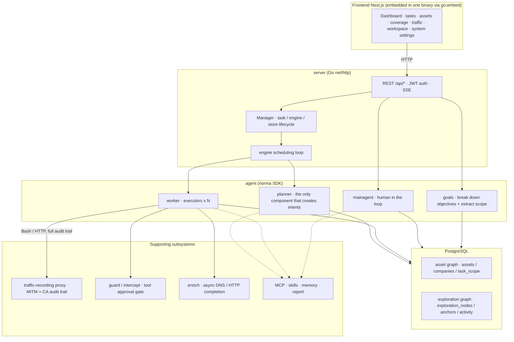
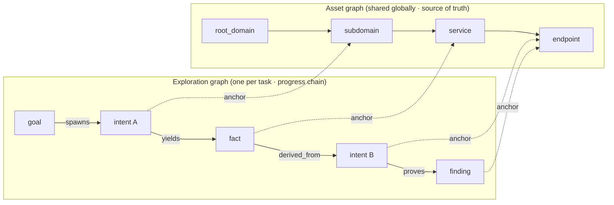
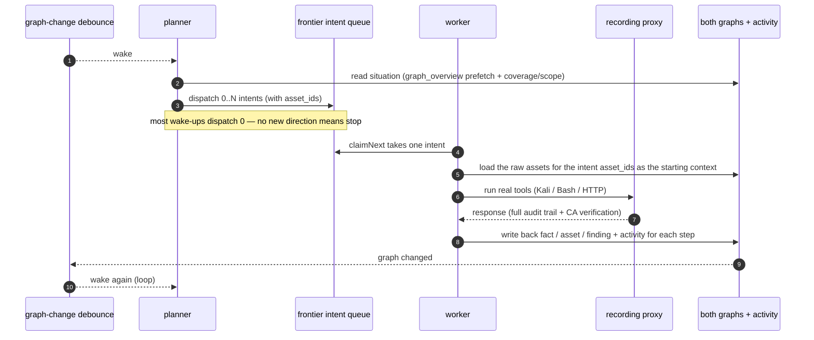
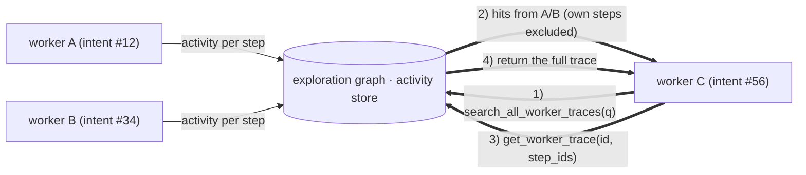
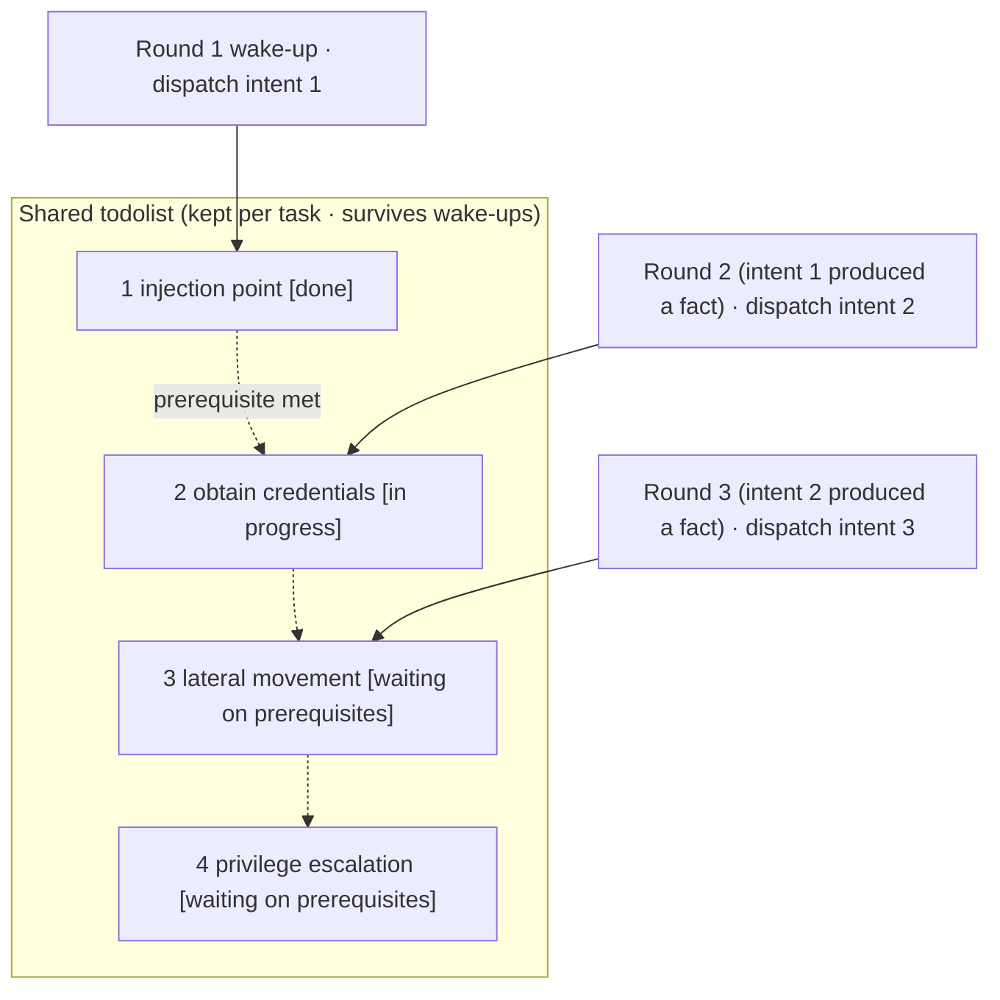

<div align="center">

# SPCX

AI autonomous penetration-testing system (Go backend + Next.js frontend)


🌐 **Online demo (mock data)**: [https://artex-demo.mhtsec.com](https://artex-demo.mhtsec.com)

📦 **This repository is a pure source-code backup of the last version of ARTEX. The original Docker image `autumn27/artex` is no longer available. This repository now maintains its own image, `mianhuatang11/artex` (Docker Hub). If pulling the image fails, run `docker compose build` to build locally from source. There are no external precompiled dependencies.**

</div>

---

## Screenshot preview

> For the full interactive experience, see the [online demo](https://artex-demo.mhtsec.com) (frontend only + mock data; no backend required).

| Dashboard (overview / token usage / activity stream) | Task list |
| :---: | :---: |
|  |  |

| Task · execution (sessions / tool calls) | Exploration graph |
| :---: | :---: |
|  |  |

| Findings | Assets |
| :---: | :---: |
|  |  |

| Asset coverage graph (force-directed layout · tested nodes highlighted · collapse and expand) |
| :---: |
|  |

| Traffic recording | Human-in-the-loop chat |
| :---: | :---: |
|  |  |

| Agent management | LLM configuration |
| :---: | :---: |
|  |  |

| Intercept approval | Backend logs |
| :---: | :---: |
|  |  |


---

## Approval record details

The global **Approval records** view, the in-task **Intercept approval** view, and approval cards in chat can all be expanded to show details. The layout follows [AegisHook’s approval detail component](https://github.com/RuoJi6/AegisHook/blob/main/web/src/components/CallDetail.vue), using ARTEX’s own components and theme.


## Asset sync (ScopeSentry)

You can sync asset data directly from [ScopeSentry](https://github.com/Autumn-27/ScopeSentry) so you do not have to collect it again:

- On the **Asset sync** page, enter the ScopeSentry address and API key to connect the data source.
- Choose what to sync by **project** or **task**, and pick asset types (domain / subdomain / IP / port / site / endpoint, and so on).
- Import in one step and merge the data into the company asset scope. It then appears in ARTEX’s asset graph for agents to explore.

---

## Installation

> Requires **PostgreSQL**. Exploration requires an **LLM** (`ANTHROPIC_API_KEY` or `OPENAI_API_KEY`; you can also configure this in the UI).

### Method 1: One-click install script (recommended)

```bash
git clone https://github.com/mhtsec/ARTEX.git
cd ARTEX
./install.sh
```

The script detects Docker and installs it if needed, then asks you to choose **(1) all Docker** or **(2) local build and run**:

- **(1) All Docker**: enter a Postgres password (press Enter for a random one) → writes `.env` automatically → `docker compose up -d`.
- **(2) Local run**: choose a database (connect to an existing one, or start one with Docker) → generates `config.json` → compiles an embedded single binary with `go` → starts it.

When it finishes, open **http://localhost:8787** (the first visit goes to `/setup` to set the admin password).

### Method 2: Docker Compose (manual)

```bash
git clone https://github.com/mhtsec/ARTEX.git
cd ARTEX
cp .env.example .env          # set POSTGRES_PASSWORD; ANTHROPIC_API_KEY is optional
docker compose up -d          # pulls mianhuatang11/artex + postgres
# → http://localhost:8787
```

> The original image `autumn27/artex` was removed from Docker Hub. This repository now maintains the image as **`mianhuatang11/artex`**.
> If the image is unavailable, or you want to change the code, build locally from source: `docker compose build && docker compose up -d`.
> The Dockerfile is a multi-stage build (frontend static export → Go static compile → runtime image). It defaults to dependency mirrors that work well from China. Override them with `--build-arg GOPROXY=...` and `--build-arg NPM_REGISTRY=...`.

The image includes common tools (ripgrep, curl, vim, npm, nmap, and others). `./skills` and `./data` are persisted with bind mounts.

Remote MCP can be set in system settings to `http` (Streamable HTTP) or `sse` (legacy SSE).
A legacy SSE server usually opens the event stream with `GET /sse`, then accepts JSON-RPC requests at the
`/message?sessionId=...` endpoint it returns. When configuring it, set the URL to `/sse` and set the header to
`Authorization=Bearer <token>`.

### Method 3: Download a prebuilt binary (Releases)

Download the zip for your platform from the original repository’s [Releases](https://github.com/Autumn-27/ARTEX/releases) (**this backup repository does not host binaries**; if those Releases are also gone, use method 2 or method 4). After extracting, you get `artex` + `start.sh` (Windows: `start.bat`) + `skills/` + `config.example.json`:

```bash
cp config.example.json config.json   # fill in the database connection
./start.sh                           # → http://localhost:8787
```

> Start with `start.sh` / `start.bat`, not by running `./artex` directly. It is a supervisor script: when the process exits, it decides whether to start it again based on the exit code. The [one-click update in the UI](#method-1-one-click-update-in-the-ui-recommended) depends on that script to swap in the new binary. If you run `./artex` directly, the new binary will not be started after an update.
> Run in the background with: `nohup ./start.sh >artex.log 2>&1 &`.

### Method 4: Build a single binary from source

```bash
# 1) Export the frontend as static files
cd web && npm ci && npm run build:static && cd ..
# 2) Copy them into the embed directory
cp -r web/out server/webui/dist
# 3) Compile (the frontend is embedded only with -tags embedui)
CGO_ENABLED=0 go build -tags embedui -o artex ./cmd/artex
./start.sh
```

### Method 5: Build cross-platform release zip files

`build.sh` builds and embeds the frontend, strips debug info with the Go linker, and packs the release files into zip archives. Release mode produces zips for Linux amd64/arm64, macOS amd64/arm64, and Windows amd64 by default:

```bash
./build.sh --release
# Output: dist/artex-0.3.3-*.zip
```

UPX-packed binaries can be incompatible with some Linux kernels, virtualization setups, or security policies, so UPX is off by default. Set targets with `ARTEX_TARGETS`. If you have confirmed the target environment can run UPX binaries, pass `--upx` to shrink them further:

```bash
ARTEX_TARGETS=linux/amd64,windows/amd64 ./build.sh --release
./build.sh --target linux/amd64 --upx
```

---

## Updates

> An upgrade replaces the program only. It does not touch data: the Postgres volume `pgdata`, `./data` (jwt.key, SQLite, and so on), and `./skills` are all kept. **You do not run database migrations by hand.** On every start, `artex` re-applies `schema.sql` in an idempotent way (including `ADD COLUMN` and `CREATE INDEX IF NOT EXISTS`), so a restart is the migration. Back up `./data` and the database before upgrading anyway.

### Method 1: One-click update in the UI (recommended)

On the **System settings** page (sidebar **System settings** → `/system/settings`), the **Version and updates** card can check for and install a new version without logging in to the server.

After you click **Update**, it downloads the release package for the current platform → checks it against the release `SHA256SUMS` → smoke-tests the new binary with `-h` → stages it as `artex.new` → the process exits, and `start.sh` / `start.bat` starts it again and finishes the swap. The page waits until the new version is up, then refreshes.

- **A failed update does not leave a broken program.** If the checksum or smoke test fails, the staged file is discarded and the current version keeps running. If the new version fails to start three times in a row after the swap, it rolls back to `artex.old` automatically (the failed binary is kept as `artex.failed` for debugging).
- **You can roll back at any time.** The previous version is kept as `artex.old`, and the card has **Roll back to the previous version**. The database schema is not rolled back.
- **An update stops tasks that are running.** An update is a restart, so do it when the system is idle.
- **Development builds are not offered an update.** Updates are disabled when the version is `dev` or when `git describe` has a suffix, so a release build does not overwrite a binary you are debugging locally.
- **Under Docker, the update replaces the program inside the container, not the image.** Toolchains baked into the image, such as Playwright and nmap, are not upgraded. Recreating the container with `docker compose up -d` returns you to the version that shipped in the image. To upgrade the image as well, use `docker compose pull artex && docker compose up -d artex`.
- If GitHub is only reachable through a proxy, set the **global proxy** on the same page. The update path uses it. Updates download only from GitHub hostnames and require HTTPS.

### Method 2: One-click update script

```bash
cd ARTEX
./update.sh
```

The script can optionally `git pull` the latest code, then asks you to choose **(1) Docker update** or **(2) local compile update** (the same split as `install.sh`):

- **(1) Docker**: you can set a target image tag (press Enter to keep `ARTEX_TAG` from `.env`; the default is `latest`) → `docker compose pull` → `docker compose up -d` (restarting with the new image runs the migration automatically).
- **(2) Local**: rebuild the frontend static files → recompile `./artex` (restart the process afterward for the new binary to take effect).

### Method 3: Docker Compose (manual)

```bash
cd ARTEX
git pull                       # update compose files / scripts (optional)
# Pin a version: set ARTEX_TAG=v0.2.0 in .env; if unset, latest is used
docker compose pull artex
docker compose up -d artex     # restart with the new image → schema migrates automatically
docker image prune -f          # remove old images (optional)
```

### Method 4: Prebuilt binary (Releases)

Download the new zip from [Releases](https://github.com/Autumn-27/ARTEX/releases), stop the old process, replace `artex` and `skills/` (keep your `config.json` and `data/`), then start again:

```bash
cp -r <extracted-dir>/skills ./ && cp <extracted-dir>/artex ./
./start.sh
```

### Method 5: Build from source

```bash
git pull
cd web && npm ci && npm run build:static && cd ..
cp -r web/out server/webui/dist
CGO_ENABLED=0 go build -tags embedui -o artex ./cmd/artex
# Restart ./start.sh
```

---

## Configuration

**Database** (`config.json`, or override with the environment variable `ARTEX_PG_DSN`):

```json
{
  "database": {
    "host": "127.0.0.1", "port": 5432,
    "user": "artex", "password": "yourpass",
    "dbname": "artex", "sslmode": "disable"
  }
}
```

**LLM**: `export ANTHROPIC_API_KEY=sk-...` (or `OPENAI_API_KEY`). You can also fill this in on the **LLM configuration** page in the UI.
Optional: `ARTEX_LLM_PROVIDER` / `ARTEX_LLM_MODEL` / `ARTEX_LLM_BASE_URL` / `ARTEX_LLM_PROXY`.

**Concurrency**: the number of worker agents per task is set in **System settings** (default 3).

**Common flags**: `./start.sh -addr :8787 -proxy :8788` (`-addr` is the frontend and API, `-proxy` is the traffic-recording proxy). The start script passes these arguments through to `artex` unchanged.

### Reverse proxy (HTTPS / expose only port 443)

The frontend and the API/SSE endpoints are served by the same backend port (default `:8787`). The live activity stream uses the **same origin** by default, so you do **not** need to set `NEXT_PUBLIC_SSE_BASE`. Expose only port 443 to the public internet and keep 8787 on the internal network.

SSE is a long-lived connection that keeps pushing events. The reverse proxy **must turn buffering off**. Otherwise the browser connects but never receives events (the activity stream spins forever). Nginx example:

```nginx
server {
    listen 443 ssl;
    server_name your.domain.com;
    # ssl_certificate / ssl_certificate_key ...

    location / {
        proxy_pass http://127.0.0.1:8787;
        proxy_set_header Host $host;
        proxy_set_header X-Forwarded-Proto $scheme;

        # SSE: buffering off, long timeout, HTTP/1.1
        proxy_buffering off;
        proxy_cache off;
        proxy_read_timeout 3600s;
        proxy_http_version 1.1;
        proxy_set_header Connection "";
    }
}
```

> Set `NEXT_PUBLIC_SSE_BASE` at **build time** only when SSE must use a different origin from the page (for example a separate subdomain). That variable is baked into the static bundle during `next build`. Setting it later, while the container is running, has no effect.

---


## Development

### Manual vulnerability retest

The **Retest** tab on the task detail page lets you page through this task’s vulnerabilities, review past conclusions and evidence, and start a retest by hand. After you start one, you stay on the current tab, which shows a spinner and **Retesting**. When a fix is confirmed, the vulnerability status is updated.

In the vulnerability list, click **Retest** in a row’s actions, or open the vulnerability and click **Start retest** in the **Vulnerability retest** section. You can optionally enter a fix version, test conditions, or limits. The system creates a separate retest agent session and keeps you on the current page. The flat list, the group-by-task view, and the asset view all have this action. While a retest is running, the UI shows a spinner and **Retesting**. Click through to the session if you want to watch it. When it finishes, the button returns to **Retest**. A retest does not require restarting the original scan. Conclusions are **Still reproducible**, **Fixed**, and **Unable to confirm**. Each conclusion, its evidence, and the session link are stored on the vulnerability.

On first start, the new backend seeds an editable **Vulnerability retest** (`retester`) agent. In Agent management you can set its prompt, LLM, runtime budget, and tools. It uses the LLM bound to that agent. If none is bound, it uses the globally active configuration. When a retest session finishes successfully with the conclusion **Fixed**, the system sets the vulnerability status to **Fixed**. A run that is still going, failed, stopped, or ended with another conclusion leaves the status unchanged. Original evidence and reports are always kept. You can also choose **Fixed** yourself from the status menu. If the same vulnerability is already being retested, the existing session is reused. After a stop, a failure, or a service restart, you can start a new retest.

In this version, history is viewed from the vulnerability detail and the session. It is not yet included in vulnerability report export or task archive packages, and it is not linked to captured traffic automatically. Demo mode only creates records that are clearly marked as simulated, and it does not contact real targets.

### Local run and tests

```bash
./dev.sh    # backend (:8787) + traffic proxy (:8788) + frontend next dev (:5173) → http://localhost:5173
```

- Backend: `go run ./cmd/artex` (without `-tags embedui`, the frontend is not embedded)
- Frontend: `cd web && npm run dev` (`/api` is proxied to the backend, with hot reload)
- Tests: `go test ./...`
- Mock preview (no backend): `cd web && NEXT_PUBLIC_MOCK=1 npm run dev`
- Redeploy the online demo (Cloudflare Pages, static export + mock data):
  ```bash
  cd web && NEXT_PUBLIC_MOCK=1 npm run build:static
  CLOUDFLARE_API_TOKEN=<token> npx wrangler pages deploy out --project-name=artex-demo --branch=main
  ```

---

## Architecture

ARTEX is an **LLM multi-agent autonomous penetration system**: a Go monolith (with the Next.js frontend embedded) plus PostgreSQL. Agent capabilities come from the [`norma`](https://github.com/Autumn-27/norma) SDK (`agentcore` / `tool` / `permission` / `harness` / `memory` / `transcript`). The core is a **dual-graph design**, plus two mechanisms that make it autonomous: **process-level information exchange between workers**, and a **planner todolist shared across rounds** that keeps attack chains stable.

### Layers



| Layer | Responsibility |
| --- | --- |
| **Frontend** | Next.js static export, embedded in the single binary with `go:embed`. Visualizes tasks, assets, the exploration graph, and the coverage graph, and provides human-in-the-loop chat |
| **server** | `net/http` routes + JWT auth + SSE. `Manager` owns the lifecycle of tasks, engines, and DB stores |
| **engine** | One `plannerLoop` and N worker goroutines per task. Claims intents, and handles timeout, pause, and drain |
| **agent** | goals / planner / worker / mainagent. `ToolSet` exposes both graphs to the LLM as tools |
| **db** | Both graphs stored in Postgres (pgx). The schema is embedded with `go:embed` and applied idempotently on every start |
| **Supporting** | Recording MITM proxy, approval gate, async enrichment, MCP / skills / memory / reports |

### Dual graph: exploration graph + asset graph

The system splits **what the target is** and **how far testing has gone** into two graphs. They are independent, and they are linked by anchors:

- **Asset graph (shared globally)**: one source of truth for assets across tasks. Nodes are `root_domain / subdomain / ip / service / app / endpoint`, owned by a company. Parent-child links (domain → subdomain → service → endpoint) and dedup keys are computed by the program. Agents only submit raw information.
- **Exploration graph (one per task)**: the thinking and progress of a single task. Nodes are `goal / intent / fact / finding / hint`, connected by edges such as `spawns / derived_from / yields / proves` into a **lineage chain**. It answers which direction came from which facts, and what that direction produced.
- **Anchors link the two graphs**: `exploration_anchors(node_id, asset_id)` attaches an intent, fact, or finding to a concrete asset. From an exploration direction you can see which assets it hit. From an asset you can see which intents tested it in this task and which facts they produced. That is what powers **asset test coverage** and the **asset coverage graph** (in-scope assets, with tested ones highlighted).



> Division of work: the **planner** reads the exploration graph, judges goals, and only puts an **intent** on the frontier when there is a new uncovered direction. A **worker** claims **one intent**, runs real tools, writes new assets, facts, and findings back to both graphs, then stops. The asset graph is shared fact. The exploration graph is the progress chain for that task.

### Engine and intent lifecycle (one exploration loop)

The engine is an **event-driven** loop. A graph change wakes the planner. The planner dispatches intents. A worker claims an intent, runs it, and writes results back. The write-back starts the next round. This continues until the goal is proven (`prove_goal`).



### Process-level information exchange between workers

During a deep exploration, useful observations (an error message, a response snippet, a hidden parameter) often appear in a worker’s **execution trace** and are never written as a formal fact. So that later workers do not repeat that work, a worker can **search other workers’ traces**:

- `search_all_worker_traces(q)`: keyword search across **other works’ execution traces in this task** (steps from its own intent are excluded). Hits include `intent_id`.
- `list_worker_traces` / `get_worker_trace(intent_id, step_ids=[…])`: first see which works have run, then fetch the full content of specific steps from one work.

Even when the exploration graph has no matching fact yet, a later worker can reuse observations from someone else’s trace. **Information moves between workers at the granularity of an execution trace**, and the boundary stays the same: each worker still only carries out the one intent it claimed.



### Shared planner todolist across rounds → stable attack chains

A real attack chain is usually a **multi-step sequence with ordering dependencies** (for example: find an injection point → obtain credentials → move laterally → escalate privileges). Dispatching all of those steps in parallel at once only creates a mess. The planner therefore keeps a **planning todolist that is stored per task and shared across wake-ups**:

- The planner is event-driven. A graph change wakes it, but **each wake-up is a new session**. The shared todolist lets it **record a serial exploit chain once**, then **dispatch intents step by step as dependencies are met** in later rounds, instead of expanding the whole chain in a single round.
- Each round dispatches an intent only for the next step whose **prerequisites are done and whose dependent facts already exist**, and updates the list as it goes (steps already satisfied by a fact are marked complete).

Attack chains therefore still **advance in order, without duplication or skipped dependencies**, even though sessions are stateless and driven by events. That is what lets ARTEX walk a multi-step exploit chain on its own.



---

## Community

Scan the QR code to follow the WeChat official account **SecSentry**, then send a private message from the account to join the discussion group.

<div align="center">


</div>

---
## References

https://github.com/oritera/Cairn


## License and disclaimer

### License

This project is licensed under the **GNU Affero General Public License v3.0 (AGPL-3.0)**. The full terms are in the [LICENSE](LICENSE) file at the repository root.

Anyone may use, modify, and distribute this project, but **derivative works must also be released under AGPL-3.0**. In particular, **if you modify this project and offer it to users over a network (for example as an online service), you must also make the corresponding complete source code available to those users**.

> ⚠️ **Important**: the open-source license itself does not limit what the software may be used for. The **permitted use** and **disclaimer** below are extra terms from the author. Please follow them.

**ARTEX is for personal learning, source-code research, and local technical verification only. Do not use it to test any live system or website.**

### Permitted use

- You may use it only to **read, learn, and study this project’s source code**, and to verify how it works in a **locally isolated environment**.
- Suitable for non-offensive uses such as personal learning, academic research, and code review.

### Prohibited use

- **Do not use this tool to scan, probe, exploit, or attack any website, online service, or networked system** (whether or not you have authorization, and whether or not you own the asset).
- Do not use this tool for any real penetration test, offensive or defensive exercise, or production environment.
- Do not use this tool for illegal intrusion, data theft, ransomware, denial of service, or any destructive or criminal activity.
- Do not use this tool in ways that violate the laws of your country or region.

### Compliance

You are responsible for complying with the cybersecurity, data-protection, and computer-crime laws of your country or region (in mainland China this includes, among others, the Cybersecurity Law, the Data Security Law, the Personal Information Protection Law, and related judicial interpretations). **You alone bear all legal liability and consequences that result from using this tool.**

### Disclaimer

This project is provided **“AS IS”**, without any express or implied warranty. The authors and contributors are not liable for any direct or indirect loss, data loss, system damage, or legal dispute caused by use of this tool, whether or not that use was appropriate. **By downloading, installing, or using this project, you confirm that you have read, understood, and agreed to all of the terms above.**
